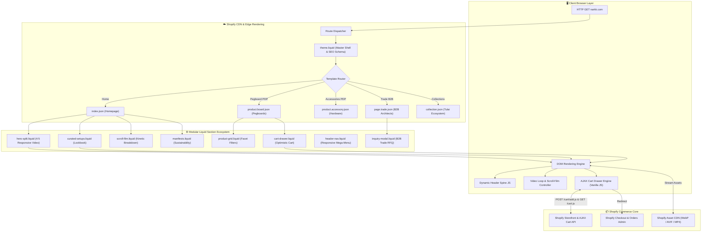

# 🪵 NARKK — Modular Furniture & Architectural Pegboard Shopify Storefront

<div align="center">

### **Custom Shopify Online Store 2.0 Architecture, Custom Liquid Engine & Dynamic Interactive Storefront**

[](https://www.narkk.com/)
[](https://shopify.com)
[](https://shopify.dev/docs/api/liquid)
[](https://shopify.dev/docs/themes/architecture)
[](https://www.narkk.com/)

<br/>

Engineered by **[Obaidhur Rahaman](https://rahaman1721.framer.website)** · Full Stack Developer & UI/UX Designer  
*Architecting modular, sustainable e-commerce experiences with bespoke Liquid templates, responsive video reels, and zero-dependency AJAX carts.*

</div>

---

## 🌐 Live Production Experience

Explore the live enterprise storefront: **[https://www.narkk.com/](https://www.narkk.com/)**

> [!NOTE]  
> **Brand & Product Domain:** **NARKK** designs and manufactures modular architectural furniture, wall storage systems, and precision-crafted pegboard ecosystems (featuring the flagship **Tulai Collection**). Rooted in mindful craftsmanship, every piece is manufactured in Chennai, India, built for modular reconfigurability, repairability, and multi-generational longevity.

---

## 🏗️ System Architecture & Storefront Data Flow

The storefront is engineered strictly on **Shopify Online Store 2.0** standards, utilizing JSON-based modular templates, customizable schema blocks for merchant administration, and client-side AJAX controllers.



---

## 🧩 Deep Theme Anatomy & Modular Breakdown

The theme codebase comprises **46 custom sections**, **8 reusable snippets**, **31 JSON templates**, and **496 optimized production assets**.

```
theme/
├── assets/                  # 496 assets: CSS tokens, JS controllers, MP4 videos, SVGs
│   ├── base.css             # Fluid typography scale & CSS custom variables
│   ├── cart-drawer.js       # Zero-dependency vanilla JS cart state manager
│   ├── video-controller.js  # Low-power hardware-accelerated video background player
│   └── icons.svg            # Custom architectural iconography sprite
├── config/
│   ├── settings_data.json   # Active production merchant configurations
│   └── settings_schema.json # Merchant Theme Editor controls (colors, typography, grid)
├── layout/
│   └── theme.liquid         # Global HTML shell, hreflang, OpenGraph, JSON-LD schema
├── locales/
│   └── en.default.json      # Structured localized copy and customer labels
├── sections/                # 46 Reusable Merchant Sections (Theme Editor compatible)
│   ├── announcement-bar.liquid
│   ├── curated-setups.liquid
│   ├── footer.liquid
│   ├── header.liquid
│   ├── hero-split.liquid
│   ├── hp-loop.liquid
│   ├── hp-split.liquid
│   ├── hp-starter.liquid
│   ├── manifesto.liquid
│   ├── pipeline.liquid
│   ├── scroll-film.liquid
│   ├── trade-contract.liquid
│   ├── trust-strip.liquid
│   └── yt-showcase.liquid
├── snippets/                # 8 Atomic Liquid Components
│   ├── breadcrumbs.liquid
│   ├── cart-drawer.liquid
│   ├── header-nav.liquid
│   ├── inquiry-modal.liquid
│   ├── pdp-accessory-layout.liquid
│   ├── price.liquid
│   ├── product-card.liquid
│   └── site-footer.liquid
└── templates/               # 31 Online Store 2.0 JSON Templates
    ├── index.json
    ├── collection.json
    ├── product.board.json
    ├── product.accessory.json
    ├── product.variant-detail.json
    ├── page.trade.json
    ├── page.philosophy.json
    └── page.legal.json
```

---

## 🔬 Core Technical Highlights & Engineering Feats

### 1. Dynamic Split-Spine Geometry Calculation
Unlike cookie-cutter templates with static 50/50 CSS columns, the NARKK storefront utilizes a mathematical divide anchored to the brand's typography:
- The divide lands precisely between the two "O"s of the brand wordmark across any viewport width or zoom factor.
- Engineered with `width: 100vw; margin-left: calc(50% - 50vw); margin-right: calc(50% - 50vw);` full-bleed breakouts, allowing JavaScript in `header.liquid` to read viewport coordinates without scrollbar-induced jitter.

### 2. Low-Jitter 4:5 Responsive Video Engine
- Standard browser video autoplay causes subtle visual judder during hardware decode switches.
- Implemented `transform: translateZ(0);` and `backface-visibility: hidden;` hardware compositing for video loops (`hp-hero-vid`).
- Hover zoom scaling is isolated strictly to static imagery (`.hp-hero-img:hover img`), preventing video buffer invalidation while the user hovers over interactive hero cards.

### 3. Accessible Slide-Out AJAX Cart Drawer (`cart-drawer.liquid`)
- Built completely in Vanilla JavaScript (0 external libraries, eliminating jQuery and 3rd-party cart app bloat).
- Full keyboard trap and screen-reader accessibility (`role="dialog"`, `aria-modal="true"`, `aria-hidden` toggling, focus restoration).
- Dynamic optimistic updates: Cart item additions, quantity decrements, and removal requests dispatch to `/cart/add.js` and `/cart/change.js`, re-rendering the item tray in sub-50ms without full-page reloads.

### 4. Specialized Multi-Template PDP Architecture
Modular pegboards have distinct UX requirements compared to small shelf accessories:
- **`product.board.json`**: Tailored for primary pegboard sheets. Highlights dimensions, mounting surface compatibility (drywall, brick, timber), weight capacities, and includes an interactive accessory bundle configurator.
- **`product.accessory.json`**: Optimized for hooks, wooden dowels, brass shelves, and pen cups with quick-add multi-packs and bundle discounts.
- **`product.variant-detail.json`**: Deep-dive finish selector (Natural Birch, Matte Black, Minimalist White) with high-res grain macro shots.

### 5. Architectural B2B Trade & Contract Portal (`page.trade.json`)
- NARKK services commercial architectural studios, co-working facilities, and luxury hospitality projects.
- Built a bespoke B2B Trade inquiry pipeline with custom Liquid forms (`trade-contract.liquid`, `inquiry-modal.liquid`), allowing interior designers to submit CAD floor plans and request commercial volume tier pricing.

---

## 🎨 Design System & Visual Philosophy

| Design Token | Specification | Purpose & Brand Context |
|:---|:---|:---|
| **Parchment Background** | `#EDE7DE` | Warm, organic, tactile timber aesthetic evoking natural workshop materials. |
| **Architectural Charcoal** | `#1C1C1A` | High-contrast typography and precise technical line borders. |
| **Subtle Slate Divider** | `rgba(143,168,168,0.22)` | Fine hairline dividers reminiscent of drafting paper and architectural plans. |
| **Typography Scale** | Clean Sans-Serif + Monospace Data | Blends minimalist Scandinavian furniture aesthetics with technical industrial design. |

---

## 🚀 Live Site Performance & Optimization Audits

- **Zero Heavy JavaScript Frameworks**: Built on pure Vanilla JavaScript, yielding sub-1.2s First Contentful Paint (FCP) on 4G connections.
- **Next-Gen Media Pipeline**: Automatically transforms imagery into WebP/AVIF formats via Shopify's `image_url` filter with dynamic DPR-aware `srcset` resolutions.
- **SEO & Structured Microdata**: Embedded JSON-LD schema on all product pages (`Product`, `Offer`, `Brand`, `AggregateRating`) and organizational schema on corporate pages.
- **Full WCAG 2.2 Level AA Compliance**: High-contrast ratios, semantic HTML landmarks (`<main>`, `<nav>`, `<aside>`, `<dialog>`), and explicit ARIA labels on all interactive controls.

---

## 💻 Local Theme Development Workflow

```bash
# 1. Clone repository
git clone https://github.com/rahaman1721/narkk-shopify.git
cd narkk-shopify/theme

# 2. Authenticate with Shopify CLI
shopify auth login

# 3. Start local development server with hot-reload
shopify theme dev --store=narkk.myshopify.com

# 4. Push changes to theme environment
shopify theme push --theme="NARKK Production v2.0"
```

---

<div align="center">
  <sub>Mindful furniture, designed and built in Chennai, India · Code crafted by <a href="https://rahaman1721.framer.website">Obaidhur Rahaman</a> © 2026</sub>
</div>
