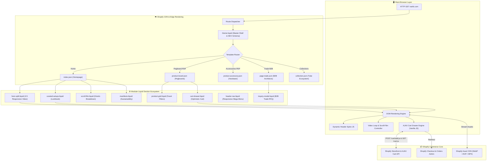

# 🪵 NARKK — Modular Furniture & Architectural Pegboard Shopify Storefront

<div align="center">

### **Custom Shopify Online Store 2.0 Architecture, Custom Liquid Engine, Zero-Dependency AJAX Cart Drawer & Dynamic Storefront**

[](https://www.narkk.com/)
[](https://shopify.com)
[](https://shopify.dev/docs/api/liquid)
[](https://shopify.dev/docs/themes/architecture)
[](https://www.narkk.com/)

<br/>

Engineered by **[Obaidhur Rahaman](https://rahaman1721.framer.website)** · Full Stack Developer & UI/UX Designer  
*Architecting modular, sustainable e-commerce experiences with bespoke Liquid templates, responsive video reels, and zero-dependency AJAX carts.*

</div>

---

## 🌐 Live Production Experience

Explore the live enterprise storefront: **[https://www.narkk.com/](https://www.narkk.com/)**

---

## 1. Project Title, Badges & Vision

### 🪵 The Vision: Mindful Furniture Made in Chennai
**NARKK** designs and manufactures modular architectural furniture, wall storage systems, and precision-crafted pegboard ecosystems (featuring the flagship **Tulai Collection**). Rooted in mindful craftsmanship, every piece is manufactured in Chennai, India, built for modular reconfigurability, repairability, and multi-generational longevity.

The storefront is engineered strictly on **Shopify Online Store 2.0** standards, utilizing bespoke Liquid sections, modular JSON templates, customizable schema blocks for merchant administration, and client-side AJAX controllers.

---

## 2. Exhaustive Module & Feature Breakdown

### 🧩 Module A: Bespoke Homepage & Visual Storytelling
- **Dynamic Split-Hero Reel (`hero-split.liquid`)**: Full-bleed responsive split grid pairing high-definition 4:5 looping video reels with direct product collection call-to-actions.
- **Dynamic Wordmark Spine Geometry**: Client-side JavaScript in `header.liquid` measures the exact pixel boundary between the two "O"s of the brand wordmark, aligning the grid split seamlessly across varying viewports.
- **Curated Room Setups Lookbook (`curated-setups.liquid`)**: Interactive spatial showcase mapping modular pegboards to real-world contexts (Creative Studio, Culinary Kitchen, Compact Workstation, Entryway Dropzone).
- **Kinetic Cinematic Scroll-Film (`scroll-film.liquid`)**: Scroll-triggered frame breakdown demonstrating precision CNC timber joinery and modular reconfigurability.
- **Sustainability Manifesto (`manifesto.liquid`, `re-beliefs.liquid`)**: Communicates repairability standards, localized timber sourcing, and zero-plastic packaging commitments.

### 🛍️ Module B: E-Commerce Storefront & Cart Lifecycle
- **Zero-Dependency AJAX Cart Drawer (`cart-drawer.liquid`)**: Pure Vanilla JavaScript slide-out drawer cart with sub-50ms optimistic updates, line item mutations, and free shipping progress meter.
- **Accessible Modal Shell**: Full keyboard trapping and screen-reader accessibility (`role="dialog"`, `aria-modal="true"`, dynamic focus restoration).
- **Multi-Template PDP Architecture**:
  - `product.board.json`: Tailored for large pegboard sheets with dimensions, mounting hardware guides, and accessory bundlers.
  - `product.accessory.json`: Optimized for modular brass shelves, wooden dowels, and hook packs with quick-add multi-packs.
  - `product.variant-detail.json`: High-res grain macro shots across wood finishes (Natural Birch, Matte Black, Minimalist White).

### 🏢 Module C: B2B Trade & Enterprise Contract Portal
- **Commercial Architect Pipeline (`page.trade.json`, `trade-contract.liquid`)**: Bespoke B2B trade portal allowing interior designers and corporate clients to submit floor plans and request commercial volume tier quotes.
- **Trade Inquiry Modal (`inquiry-modal.liquid`)**: Specialized form integration collecting project scope, timber preference, and estimated lead times.

---

## 3. System Architecture & Tech Stack



| Layer | Technology | Architectural Function |
|:---|:---|:---|
| **Theme Engine** | Shopify Liquid (OS 2.0) | Dynamic server-side page rendering and merchant customization schema. |
| **Markup & Semantics** | HTML5 (Semantic Landmarks) | Accessible document hierarchy (`<main>`, `<nav>`, `<aside>`, `<dialog>`). |
| **Styling & Design Tokens** | CSS3 (Custom Properties & Flex/Grid) | Architectural parchment aesthetic (`#EDE7DE`) and fluid typography. |
| **Client Interactivity** | Vanilla JavaScript (ES6+) | 0-dependency controllers for video playback, drawer cart, and wordmark spine calculations. |
| **Platform & APIs** | Shopify Storefront API & Asset CDN | High-speed global edge caching and automated WebP/AVIF format transcoding. |

---

## 4. Complete Folder Structure

```
theme/
├── assets/                               # 496 Production Assets (CSS, JS, Videos, Icons)
│   ├── base.css                          # Global typography scale & CSS custom variables
│   ├── cart-drawer.js                    # Zero-dependency vanilla JS cart state manager
│   ├── video-controller.js               # Hardware-accelerated video background player
│   └── icons.svg                         # Architectural SVG iconography sprite
├── config/                               # Merchant Schema & Production Settings
│   ├── settings_data.json                # Active production merchant configurations
│   └── settings_schema.json              # Merchant Theme Editor controls (colors, fonts, layout)
├── layout/                               # Master Document Layout Shells
│   └── theme.liquid                      # Global HTML shell, OpenGraph tags, JSON-LD structured data
├── locales/                              # Localization & Strings
│   └── en.default.json                   # Structured localized copy and customer labels
├── sections/                             # 46 Reusable Merchant Sections (Theme Editor compatible)
│   ├── announcement-bar.liquid           # Top notification ticker with dismiss trigger
│   ├── curated-setups.liquid             # Interactive room lookbook & hotspot selectors
│   ├── footer.liquid                     # Multi-column navigational footer & compliance links
│   ├── header.liquid                     # Wordmark navigation & dynamic split-spine JS
│   ├── hero-split.liquid                 # 4:5 responsive video loop & split CTA grid
│   ├── hp-loop.liquid                    # Seamless looping promotional banner
│   ├── hp-starter.liquid                 # Modular starter bundle configurator
│   ├── manifesto.liquid                  # Sustainable craft philosophy & materials transparency
│   ├── pipeline.liquid                   # Step-by-step modular assembly guide
│   ├── scroll-film.liquid                # Frame-by-frame kinetic product breakdown
│   ├── trade-contract.liquid             # Commercial B2B architect quotation form
│   └── trust-strip.liquid                # Reassurance badges (10-Yr Guarantee, Plastic-Free)
├── snippets/                             # 8 Atomic Liquid Components
│   ├── breadcrumbs.liquid                # Accessible navigational breadcrumbs
│   ├── cart-drawer.liquid                # Slide-out AJAX cart with free shipping meter
│   ├── header-nav.liquid                 # Multi-level mega menu navigation
│   ├── inquiry-modal.liquid              # B2B Trade RFQ modal form
│   ├── pdp-accessory-layout.liquid       # Modular accessory bundle card layout
│   ├── price.liquid                      # Currency formatter & sale badge renderer
│   └── product-card.liquid               # Reusable product grid item with hover image switch
└── templates/                            # 31 Online Store 2.0 JSON Templates
    ├── index.json                        # Homepage section ordering & content blocks
    ├── collection.json                   # Tulai collection grid & facet filters
    ├── product.board.json                # Specialized pegboard modular sheet PDP
    ├── product.accessory.json            # Hardware & accessory add-on PDP
    ├── page.trade.json                   # B2B interior designer & architect portal
    └── page.philosophy.json              # Brand storytelling & Chennai workshop roots
```

---

## 5. Screen / Route & Template Inventory

### Primary Storefront Templates & Routes

| URL / Route | JSON Template | Primary Purpose |
|:---|:---|:---|
| `/` | `index.json` | **Homepage**: Hero video split, curated setups lookbook, sustainability manifesto. |
| `/collections/tulai` | `collection.json` | **Flagship Ecosystem**: Tulai modular pegboards, accessories, and category facet filters. |
| `/products/:handle` (Boards) | `product.board.json` | **Modular Board PDP**: Mounting specs, dimensions, surface guide, accessory bundles. |
| `/products/:handle` (Accessories) | `product.accessory.json` | **Hardware PDP**: Multi-pack quantity selector, finish selector, 1-click add to cart. |
| `/pages/trade` | `page.trade.json` | **B2B Trade Portal**: Commercial architectural quotations and CAD upload pipelines. |
| `/pages/philosophy` | `page.philosophy.json` | **Brand Manifesto**: Mindful Chennai manufacturing and circular repairability standards. |

---

## 6. Getting Started (Local Setup & Installation)

### Prerequisites
- **Shopify CLI**: v3.0 or higher (`npm install -g @shopify/cli @shopify/theme`).
- **Ruby**: v3.0+ (for local theme development).
- **Access**: Collaborator or developer access to the NARKK Shopify store.

### 1. Clone Repository
```bash
git clone https://github.com/rahaman1721/narkk-shopify.git
cd narkk-shopify/theme
```

### 2. Authenticate with Shopify CLI
```bash
shopify auth login
```

### 3. Launch Local Hot-Reload Development Server
```bash
shopify theme dev --store=narkk.myshopify.com
```
Opens a live local preview tunnel at **[http://127.0.0.1:9292](http://127.0.0.1:9292)** with instant hot reloading of Liquid, CSS, and JS changes.

### 4. Push Theme Updates to Production
```bash
shopify theme push --theme="NARKK Production v2.0"
```

---
---

## 👨‍💻 Author

**Obaidhur Rahaman**  
Full Stack Developer & Lead UI/UX Designer  

- 🌐 **Portfolio**: [https://rahaman1721.framer.website](https://rahaman1721.framer.website)  
- 🐙 **GitHub**: [@rahaman1721](https://github.com/rahaman1721)  
- 💼 **LinkedIn**: [linkedin.com/in/obaidhur-rahaman-1721z](https://www.linkedin.com/in/obaidhur-rahaman-1721z)  
- 📧 **Email**: [rahaman171920@gmail.com](mailto:rahaman171920@gmail.com)  

<div align="center">
  <sub>Designed & Developed with precision by Obaidhur Rahaman © 2026</sub>
</div>
